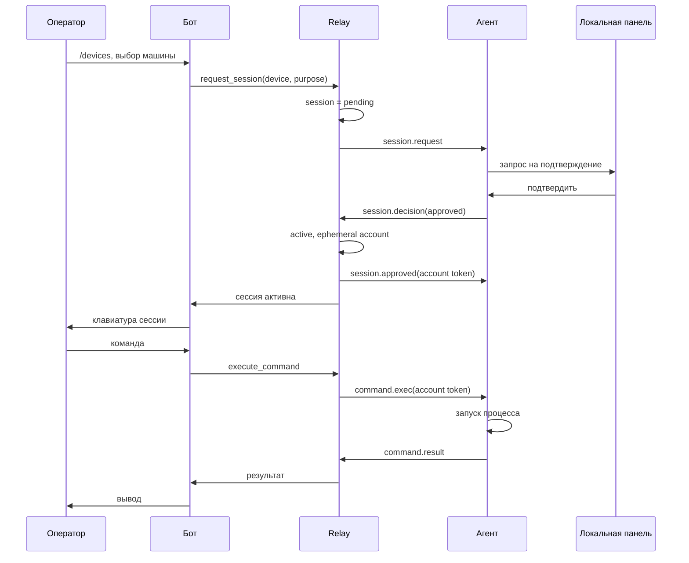

# Архитектура

## Принцип

Каждая сессия проходит через три независимых решения:

1. Оператор прошёл аутентификацию в боте и имеет право на устройство.
2. Устройство установило исходящее соединение и находится в сети.
3. Владелец устройства подтвердил конкретный запрос в локальной панели.

Только после всех трёх создаётся сессионная учётная запись, и только она
принимается исполнителем команд. Ни одна сторона не может открыть сессию
в одиночку.

## Компоненты

### rsb server

Один процесс, три роли:

- Telegram-бот на aiogram: интерфейс оператора.
- Relay на FastAPI: WebSocket для агентов, HTTP для enrollment и health-check.
- Хранилище: SQLite в WAL-режиме, доступ через aiosqlite.

Сервер знает устройства, сессии и аудит, но не хранит вывод команд дольше
настроенного срока и не хранит снимки экрана.

### rsb agent

Процесс на машине пользователя:

- Устанавливает исходящее WSS-соединение с relay.
- Проходит HMAC-рукопожатие по выданному при enrollment секрету.
- Принимает запросы сессий и показывает их в локальной панели.
- Исполняет команды в отдельном процессе на каждую команду.
- Делает снимок экрана только по запросу внутри активной сессии.
- Отдаёт локальную панель на 127.0.0.1, наружу не слушает.

### Локальная панель

FastAPI-приложение внутри агента, доступно только на loopback и только
с UI-токеном. Показывает состояние соединения, входящие запросы, активные
сессии, журнал команд и последний отправленный снимок. Позволяет
подтвердить, отклонить и завершить сессию.

Панель заблокирована паролем хоста. Пароль задаётся при установке и хранится
только на машине в виде scrypt-хэша. Пока панель заблокирована, подтверждение
подключений и изменение прав недоступны. Автоблокировка выполняется после
`RSB_AGENT_LOCK_TIMEOUT_SECONDS` без действий.

## Права и согласие

Устройство хранит политику допустимых прав: `shell` и `screenshot`.
По умолчанию разрешён только `shell`. Владелец машины включает `screenshot`
в локальной панели и может выключить его в любой момент.

Оператор при запросе выбирает права в пределах политики устройства. Хост
при подтверждении видит запрос и итоговый набор прав, может сократить его
или отклонить подключение целиком. Итоговые права фиксируются в сессии
и в учётной записи сессии; агент проверяет их на каждой команде и каждом
снимке.

Выданные права сохраняются в `access_grants` и показываются владельцу как
история доступа. Новое подключение всё равно требует подтверждения: история
нужна для прозрачности и для предзаполнения запроса, а не для обхода согласия.

Права можно сократить в любой момент активной сессии. Панель отправляет
`session.capabilities`, сервер обновляет сессию и её учётную запись, агент
получает `session.update` и перестаёт принимать отозванные действия. Если
право `screenshot` отозвано, сохранённый снимок удаляется из памяти агента,
а следующий запрос снимка отклоняется сервером и агентом. Изменение политики
устройства автоматически применяется ко всем открытым сессиям; сессия без
оставшихся прав закрывается.

## Поток подключения



## Жизненный цикл сессии

```
pending ──approve──> active ──close──> closed
   |                   |
   ├──deny────────────> denied
   ├──ttl─────────────> expired
   └──device offline──> closed
```

Правила:

- Одна активная или ожидающая сессия на оператора.
- Одна активная сессия на устройство.
- `pending` живёт `RSB_SESSION_REQUEST_TTL_SECONDS`; без ответа хоста запрос
  истекает и закрывается.
- `active` живёт `RSB_SESSION_TTL_SECONDS`.
- Права сессии не могут превышать запрошенные оператором и разрешённые
  политикой устройства.
- При потере соединения агента активные сессии закрываются.
- При закрытии сессии её учётная запись отзывается немедленно.

## Сессионные учётные записи

На каждую подтверждённую сессию сервер создаёт запись в `session_accounts`:
имя вида `rsb-<8 hex>`, случайный токен, набор прав и TTL. Токен передаётся
агенту один раз в сообщении `session.approved` и хранится только в памяти
процесса агента. Каждая команда и каждый снимок экрана проверяются по этому
токену и по набору прав учётной записи.

Учётная запись не связана с Telegram-пользователем напрямую: она живёт
только столько, сколько живёт сессия.

## Исполнение команд

Каждая команда запускается отдельным процессом:

- Linux и macOS: `/bin/bash -lc <command>`.
- Windows: `powershell -NoProfile -NonInteractive -Command <command>`.

Рабочий каталог хранится в состоянии сессии. Команды `cd` перехватываются
агентом и меняют каталог без запуска процесса. Вывод читается потоком,
обрезается по `RSB_COMMAND_MAX_OUTPUT_BYTES`, команда прерывается по
`RSB_COMMAND_TIMEOUT_SECONDS`. Переменные окружения с префиксом `RSB_`
удаляются перед запуском.

## Снимки экрана

Запрос приходит только от активной сессии, в которой хост выдал право
`screenshot`. Сервер проверяет право до отправки запроса агенту, агент
проверяет его повторно. Если право не выдано, запрос не проходит ни на одном
уровне.

Агент делает снимок основного монитора, уменьшает его до 1600 px по длинной
стороне, кодирует в JPEG с понижением качества до лимита
`RSB_SCREENSHOT_MAX_BYTES`. Снимок сохраняется в памяти агента для показа
владельцу и отправляется оператору. На сервере снимок не хранится. На хосте
фиксируется факт снимка в локальном журнале.

## Хранилище

SQLite, WAL, `foreign_keys=ON`, `busy_timeout=5000`.

| Таблица | Назначение |
|---|---|
| `operators` | Telegram-операторы, TOTP, срок авторизации |
| `enrollment_tokens` | одноразовые токены установки |
| `devices` | машины, зашифрованный секрет, политика прав, владелец, статус |
| `sessions` | сессии, запрошенные и выданные права, состояния |
| `session_accounts` | одноразовые учётные записи сессий и их права |
| `access_grants` | последние выданные права по паре устройство-оператор |
| `commands` | журнал команд и усечённый вывод |
| `audit` | события безопасности и действий |
| `schema_meta` | версия схемы |

Секрет устройства и секреты TOTP шифруются ключом сервера (Fernet, ключ
выводится через HKDF из `RSB_SECRET_KEY`). Токены сессий хранятся в виде
SHA-256. Пароль хоста на сервер не передаётся: только scrypt-хэш на машине.

## Развёртывание

Рекомендуется:

- отдельный VPS, reverse proxy с TLS (Caddy или nginx);
- `RSB_PUBLIC_URL` указывает на `wss://`;
- SQLite на локальном диске, регулярные бэкапы;
- systemd-юнит для сервера, ограничение прав пользователя;
- журналы в stdout, ротация на уровне системы.

Агент установляется через `install.py`, регистрируется как пользовательский
сервис: systemd user unit на Linux, задача планировщика на Windows, launchd
на macOS.
